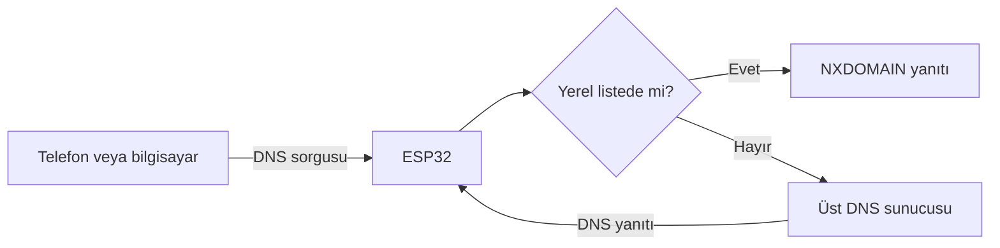

# Masa Nabzı

**ESP32 dokunmatik panelinde bilgisayar, ağ, borsa ve DNS takibi.** Oyun sırasında GPU sıcaklığına bakabilir, bağlantı yavaşladığında ping değerini kontrol edebilir veya telefonunun son sorguladığı alan adını ekranda görebilirsin. Bilgisayar ölçümlerini ve BIST fiyatlarını iki küçük Python betiği gönderir. DNS hizmeti kartın üzerinde çalışır.

| Menü | Ekranda ne var? |
| --- | --- |
| **PC** | CPU ve GPU kullanımı, GPU sıcaklığı, RAM yüzdesi, kullanılan ve toplam bellek |
| **NETWORK** | Bilgisayarın ölçtüğü internet erişimi ve ping, bilgisayarın ve kartın yerel IP adresleri |
| **BIST** | TradingView üzerinden alınan TBORG, NETGL ve TRHOL fiyatları. Betik her sorgudan sonra 15 saniye bekler. |
| **DNS** | Hizmet durumu, toplam sorgu, engel sayısı ve oranı, son sorgulanan ve son engellenen alan adı |

## Kullanılan kart

Proje **ESP32-2432S028** kartını, **2,8 inç** dokunmatik TFT ekranı dikey **240 × 320 piksel** olarak kullanacak şekilde yapılandırır. Bu kurulumda TFT_eSPI ekranı `ILI9341_2_DRIVER` ile sürer. Rezistif dokunmatiği ayrı bir **XPT2046** denetleyicisi okur. [Üreticinin rezistif model için teknik föyü](https://www.guition.com/icms/upload/fb081940d6fc11f09850077a33e1404f/file/productmanager-productfile/51f2ead6ce314ca08ce56d03ab0caff6/Directory/ESP32-2432S028%20Specifications-EN_1776047154241.pdf)

Aşağıdaki sayılar ESP32'nin **GPIO numaralarıdır**. Ekran için TFT_eSPI ayarına, dokunmatik ve microSD için kart yazılımına karşılık gelir.

| Birim | SCK | MOSI | MISO | CS | Diğer bağlantılar |
| --- | ---: | ---: | ---: | ---: | --- |
| TFT ekran | 14 | 13 | 12 | 15 | DC 2, arka ışık 21 (HIGH), RST −1 |
| XPT2046 dokunmatik | 25 | 32 | 39 | 33 | Dokunma kesmesi (IRQ) 36 |
| microSD yuvası | 18 | 23 | 19 | 5 | Açılışta `/blocklist.txt` okunur |

Dokunmatik ile microSD farklı pinlerde aynı **VSPI** denetleyicisini kullanır. Bu yüzden kart açılırken önce SD'deki listeyi belleğe alır. Ardından SD bağlantısını kapatıp VSPI'yi dokunmatik için başlatır. Listede yaptığın değişiklikler kart yeniden başlatıldığında geçerli olur.

<details>
<summary>Bu kartta kullanılan Arduino ve ekran ayarları</summary>

| Ayar | Değer |
| --- | --- |
| Kart profili | ESP32 Dev Module (`esp32:esp32:esp32`) |
| ESP32 kart paketi | 3.3.12 |
| İşlemci ve flash | 240 MHz CPU, 4 MB flash, QIO / 80 MHz, varsayılan bölüm düzeni |
| PSRAM | Devre dışı |
| TFT_eSPI | SPI yazma 40 MHz, okuma 16 MHz. Panelde kullanılan yazı tipleri için `LOAD_GLCD` ve `LOAD_FONT2` etkin. |
| Dokunmatik kalibrasyonu | X 359–3675, Y 255–3518. Yazılım bu aralıkları ekranın 0–239 ve 0–319 koordinatlarına dönüştürür. |
| Seri monitör | 115200 baud |

</details>

## İlk kurulum

### Yapmanız gereken ağ ayarları

> [!IMPORTANT]
> Kartı derlemeden önce `EKran.ino` ile **aynı klasörde** `network_settings.h` dosyasını oluşturmanız gerekir. Kendi Wi-Fi ve IP bilgilerinizi bu kopyaya yazın. Kart yazılımındaki `#include "network_settings.h"` satırı ayarları buradan okur.

1. [Örnek ağ ayarları dosyasını](EKran/network_settings.example.h) aynı klasöre `network_settings.h` adıyla kopyalayın. Windows'ta projenin ana klasöründe PowerShell açarak şu komutu çalıştırabilirsiniz.

   ```powershell
   Copy-Item .\EKran\network_settings.example.h .\EKran\network_settings.h
   ```

2. Oluşturduğunuz **`EKran/network_settings.h`** dosyasını açın ve şu beş alanı doldurun.

   | Alan | Yazmanız gereken değer |
   | --- | --- |
   | `ssid` | Wi-Fi ağınızın adı, çift tırnak içinde |
   | `password` | Wi-Fi parolanız, çift tırnak içinde |
   | `localIP` | ESP32 için ağınızda ayırdığınız sabit IP adresi |
   | `gateway` | Modeminizin veya yönlendiricinizin yerel IP adresi |
   | `subnet` | Wi-Fi bağlantınızın alt ağ maskesi |

   IP adreslerini örnek dosyadaki gibi dört sayıyı virgülle ayırarak yazın. Windows'ta `ipconfig` komutu ağ geçidini ve alt ağ maskesini gösterir. Dosyayı kaydedin. `network_settings.h` Git tarafından yok sayılır.

### Karta yükleme

1. Arduino IDE'de **esp32 by Espressif Systems** kart paketini, **TFT_eSPI** ve **XPT2046_Touchscreen** kütüphanelerini kurun. TFT_eSPI'nin seçili kullanıcı ayarında yukarıdaki ekran sürücüsünü ve TFT pinlerini tanımlayın.
2. [Kart yazılımını](EKran/EKran.ino) Arduino IDE'de açın. **ESP32 Dev Module** ve kartın USB portunu seçip yükleyin. Kartın adresini **NETWORK → ESP IP** satırında görebilirsiniz.

## İlk bağlantı testi

Windows PowerShell'de kartın IP adresini bir kez gir. İlk komut kartın web sunucusunu, ikincisi doğrudan kartın DNS hizmetini sınar.

```powershell
$env:ESP32_IP = Read-Host "Kartın yerel IP adresi"
Invoke-RestMethod "http://$env:ESP32_IP/hello"
nslookup -type=A iana.org $env:ESP32_IP
```

İlk komut **HELLO ESP32** döndürür. DNS sorgusu sırasında karttaki **DNS → QUERIES** sayacı ilerler. Günlük kullanım için bilgisayarının veya telefonunun Wi-Fi ayarlarında DNS sunucusu olarak aynı IP'yi seç.

## Bilgisayar ve BIST verileri

Windows'ta Python 3 ile proje klasöründen çalıştır. PC betiği GPU ölçümü için `nvidia-smi` komutunu kullandığından, bu ekranın veri alması için komutun çalıştığı bir NVIDIA kurulumu gerekir.

```powershell
py -m pip install psutil requests
$env:ESP32_IP = Read-Host "Kartın yerel IP adresi"
py cpu_gonder.py
```

BIST ekranını da beslemek için ikinci bir PowerShell penceresi aç. `ESP32_IP` değişkeni her pencereye özeldir.

```powershell
$env:ESP32_IP = Read-Host "Kartın yerel IP adresi"
py bist_gonder.py
```

## DNS filtresi ve microSD



`py blocklist_hazirla.py` komutu Türkiye odaklı iki listeye öncelik verir, tekrarları kaldırır ve kalan kapasiteyi HaGeZi Light'tan doldurur. Üretilen **en fazla 12.000 alan adı** kullanıcının `Desktop/blocklist.txt` dosyasına yazılır. [Turkish-Ad-Hosts](https://github.com/symbuzzer/Turkish-Ad-Hosts) · [turk-adlist](https://github.com/bkrucarci/turk-adlist) · [HaGeZi DNS Blocklists](https://github.com/hagezi/dns-blocklists)

1. `blocklist.txt` dosyasını FAT32 microSD kartın kök dizinine kopyala, kartı tak ve ESP32'yi yeniden başlat.
2. Seri monitörde `Blocklist yuklendi:` satırında kaç kayıt okunduğunu kontrol et. Yerel listedeki bir alan adı ve onun alt alan adları aynı kurala eşleşir.
3. Denemek için `nslookup -type=A` komutuna listeden bir alan adı ve ardından kartın IP adresini ver. **LAST BLOCK** satırında sorguladığın adı görebilirsin.

SD kart veya liste bulunamazsa sorgular üst DNS sunucusuna (`76.76.2.37`) iletilir. **BLOCKED** sayacı, yerel eşleşmelerin yanı sıra üst sunucudan gelen `NXDOMAIN` ve `A = 0.0.0.0` yanıtlarını da sayar. Var olmayan bir alan adı da `NXDOMAIN` döndürebildiği için sayaç bu sorguları içerir.
